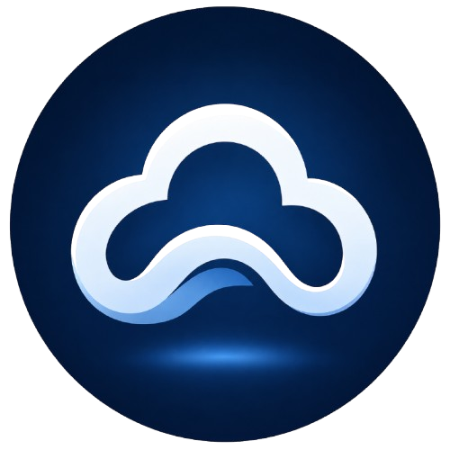

<div align="center">



# Francesc Castell · Portfolio

Personal site and AIOps service landing for a Cloud Engineer working on
multi-account AWS, Terraform and AI operations.

[Portfolio](https://francastell.com) · [AIOps](https://aiops.francastell.com) · [Stack](#stack) · [Deploy](#deploy)

</div>

---

## Overview

Two surfaces, one codebase:

| Surface | Audience | Job |
| :--- | :--- | :--- |
| `francastell.com` | Hiring managers, recruiters, engineers | Show the work and get interviews |
| `aiops.francastell.com` | CTOs, platform leads, SRE leads | Explain a read-only AIOps service and open a conversation |

The portfolio is a static, editorial site: home, about, experience, projects,
stack, contact, 404, plus dynamic `robots.txt` and `sitemap.xml`. The AIOps
landing is a single page with a canvas simulation of an incident investigation.

No client-side framework. No database. One worker, static assets and one
`<canvas>` animation.

## Stack

| Layer | Choice |
| :--- | :--- |
| Framework | Astro 5.18 (static output) |
| Styling | Tailwind CSS v4 (`@theme`, `@utility`, `@custom-variant`) |
| Language | TypeScript (strict) |
| Fonts | Inter, Inter Tight, JetBrains Mono (self-hosted woff2) |
| Runtime | Cloudflare Workers + Static Assets |
| Deploy | Workers Builds, on every push to `main` |

## Structure

```
.
├── public/
│   ├── fonts/                  # self-hosted woff2
│   ├── og-image.{svg,png}      # 1200×630 social card
│   └── favicon*, icon-*        # favicon and PWA icons
├── src/
│   ├── pages/
│   │   ├── index.astro         # hero, focus, selected work, CTA
│   │   ├── about.astro         # background, day to day, principles
│   │   ├── experience.astro    # platform scope + career timeline
│   │   ├── projects.astro      # role and outcome per project
│   │   ├── stack.astro         # skill groups
│   │   ├── contact.astro       # channels
│   │   ├── aiops.astro         # service landing + canvas animation
│   │   ├── 404.astro
│   │   ├── robots.txt.ts
│   │   └── sitemap.xml.ts
│   ├── layouts/
│   │   ├── BaseLayout.astro    # portfolio shell: nav, footer, SEO, theme
│   │   ├── PageLayout.astro    # inner page: eyebrow, heading, lede
│   │   └── LandingLayout.astro # AIOps landing: minimal, noindex
│   ├── components/
│   │   ├── Nav.astro
│   │   ├── MobileMenu.astro
│   │   ├── ThemeToggle.astro
│   │   ├── ScrollChrome.astro
│   │   ├── Footer.astro
│   │   └── Seo.astro
│   ├── data/                   # typed content
│   │   ├── site.ts
│   │   ├── focus.ts
│   │   ├── experience.ts
│   │   ├── projects.ts
│   │   ├── skills.ts
│   │   └── certifications.ts
│   ├── styles/global.css       # @theme tokens, fonts, base, utilities
│   └── worker.ts               # host rewrite for the AIOps subdomain
├── wrangler.toml
└── .agents/skills/             # project skills for AI agents
```

## Commands

Node 24 is required.

```bash
export PATH="$HOME/.nvm/versions/node/v24.12.0/bin:$PATH"

npm install
npm run dev        # http://localhost:4321
npm run build      # static build to dist/
npm run preview    # serve the build locally
```

## Deploy

Push to `main`. Cloudflare Workers Builds runs `npm run build` and deploys the
worker with static assets. There is no manual step.

`wrangler.toml` runs the worker before assets (`run_worker_first = true`) so the
subdomain rewrite works:

- `aiops.francastell.com/` → `/aiops`
- `francastell.com/aiops` → `301` to the subdomain

DNS: `AAAA aiops` → `100::`, proxied, plus a worker route
`aiops.francastell.com/*`. See `.agents/skills/deploy-cloudflare/SKILL.md`.

## Content

All copy lives in `src/data/*.ts` or at the top of each page. Rules:

- No client names. Sectors only.
- No metrics without evidence.
- Personal work in first person; team work as environment.
- Only `active` certifications are claimed.
- `LLMOps` is not used for operations. It is AIOps.

See `.agents/skills/site-content/SKILL.md` for the full policy.

## AIOps landing

`src/pages/aiops.astro` contains the offer and the animation. The canvas draws
alert particles, beams to three sources, a pulsing agent core and a shockwave.
It is driven by a small state machine and respects `prefers-reduced-motion`.

The page carries `noindex, nofollow` until the commercial and legal situation is
resolved. See `.agents/skills/aiops-landing/SKILL.md`.

## Accessibility and performance

- Skip link, visible focus, semantic landmarks.
- `prefers-reduced-motion` disables reveals and the canvas animation.
- Self-hosted fonts with preload; no third-party requests.
- Static HTML, one small CSS bundle, no client-side framework.

## License

Source code is private. The content (bio, experience, projects) is the personal
IP of Francesc Castell.
